# YuuuuKi制作 Minecraft配布ワールド

## ワールドのダウンロード統計

Release の添付ファイルの累計ダウンロード数を、日本時間の実行時点ごとに表示します。
履歴はこの方式での最初の実行日から記録されます。添付ファイルが削除された場合など、
GitHub API から取得できる対象ファイルが減ると、合計値も減少することがあります。

### 全ワールド累計ダウンロード数
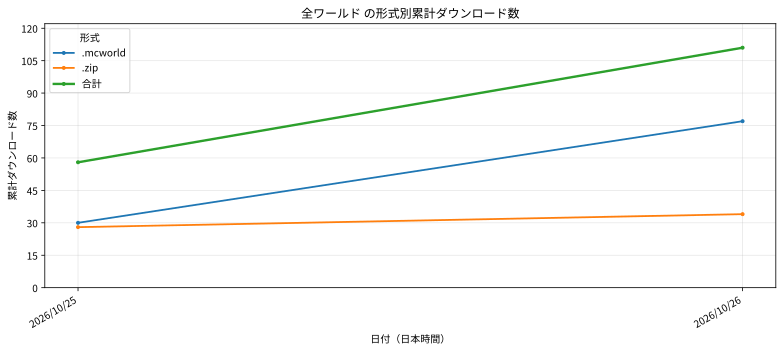

### 脱獄のアイデア
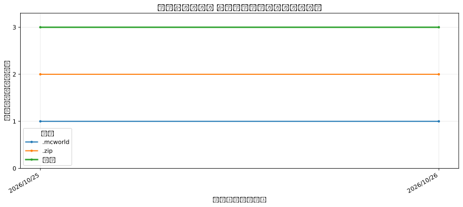

### メゾン舞倉
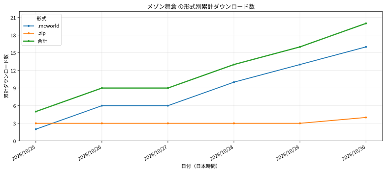

### かくれんぼ村からの脱出
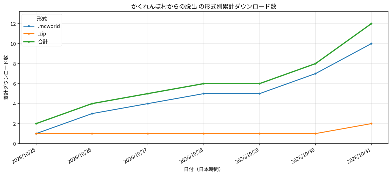

### 脱出マップテンプレート
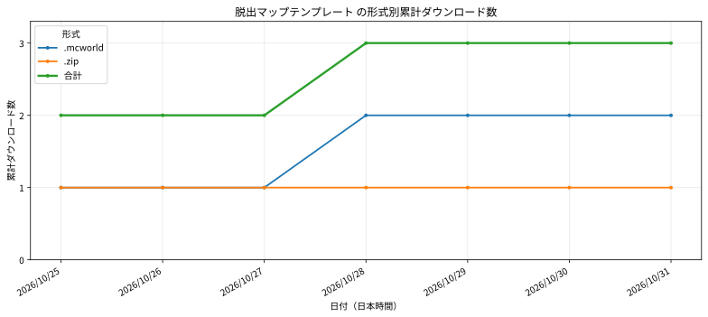

### エンドレス・スピーチ
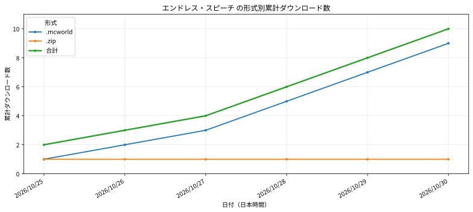

### 恋したナースは行方不明
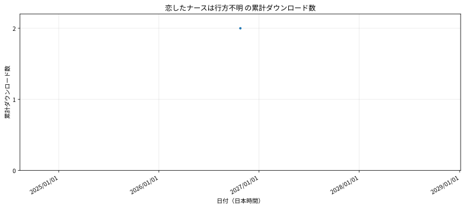

### 初詣に行こう！
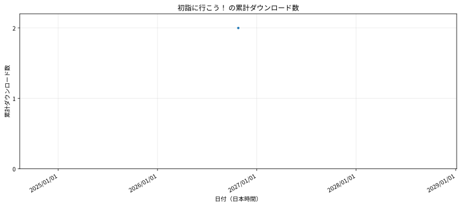

### 境界の夜祭
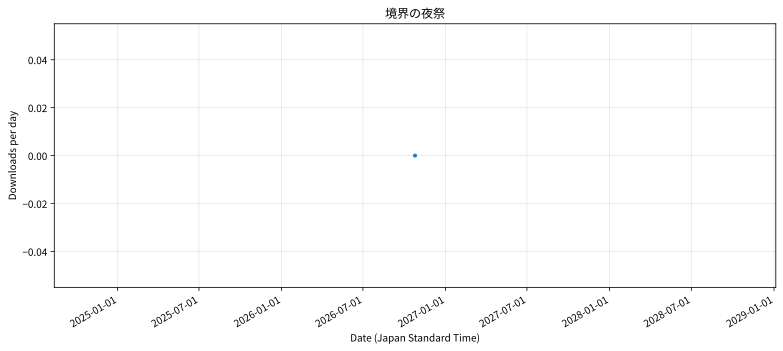

### ブラック企業からの退社
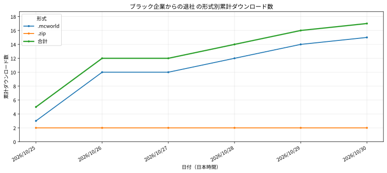

### PARADISE BREAK
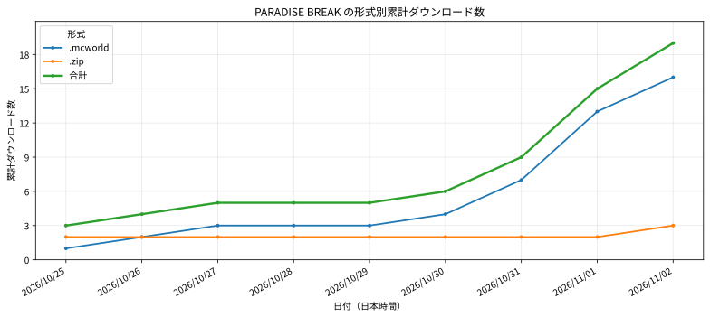

### 豪華客船からの招待状
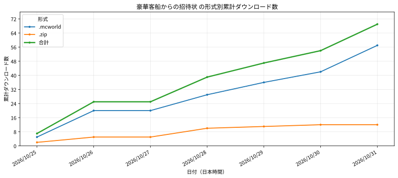

### 夏のビーチのとある一日
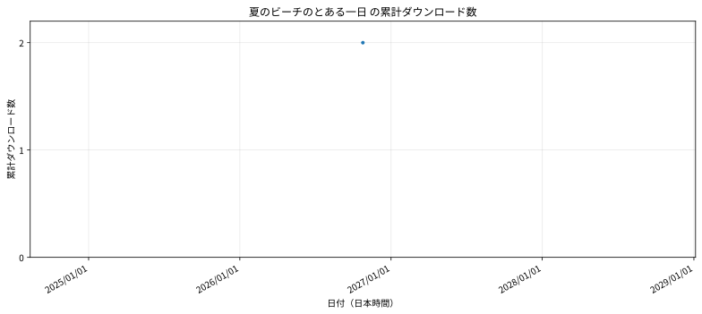

### 太古の石に連れられて～迷宮編～
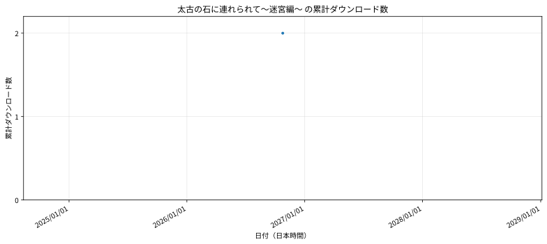

### 太古の石に連れられて～研究所編～
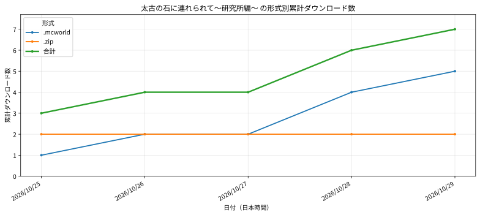

### 敵のアジトは温泉旅館
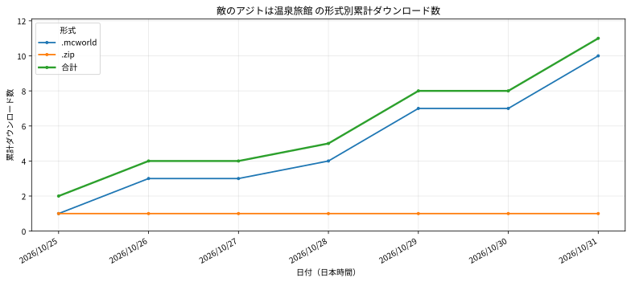

### 消えた村人たちと湖の秘密
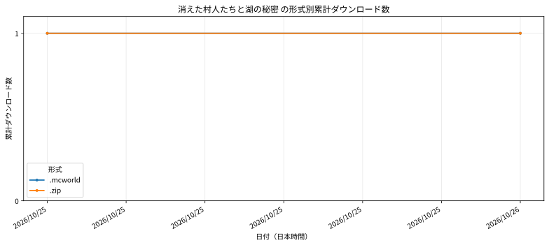

### 海上美術館に隠された秘密
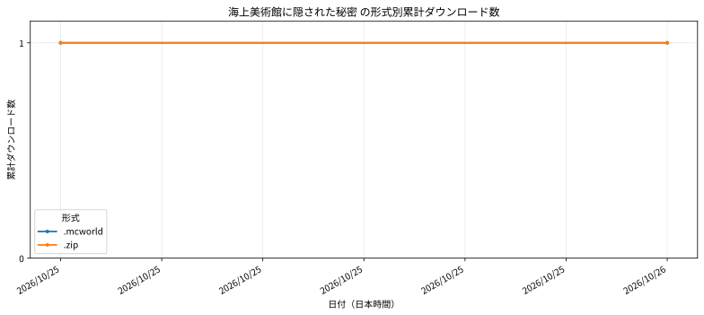

### 動物園の謎を解け!!
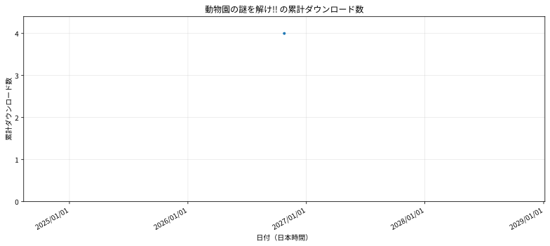